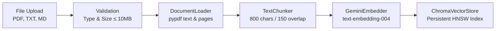

# DocChat AI 📚🤖

A production-grade Retrieval-Augmented Generation (RAG) application that allows users to upload documents (PDFs, text) and ask questions that are answered **strictly and exclusively** from those documents, with ground-truth citations.

---

## 🛠️ Technology Stack

| Layer | Technology | Details |
|---|---|---|
| **Backend Framework** | FastAPI (Python 3.11+) | Asynchronous, typed REST API with automatic OpenAPI docs |
| **Settings Management**| Pydantic-Settings | Strongly-typed environment variable loader from `.env` |
| **Vector Database** | ChromaDB | Local, persistent vector store (behind swappable `BaseVectorStore` interface) |
| **LLM Provider** | Google Gemini (Free tier) | `google-generativeai` SDK (behind swappable `BaseLLM` interface) |
| **Embeddings** | Gemini text-embedding-004 | High-dimensional dense embeddings (behind swappable `BaseEmbedder` interface) |
| **Document Processing**| PyPDF & Text Chunkers | Page-level extraction and overlapping window chunking |
| **Frontend Framework** | React + Vite (JavaScript) | Blazing-fast client application with Tailwind CSS |

---

## 📁 Project Structure

```text
docchat-ai/
├── backend/
│   ├── app/
│   │   ├── main.py            # FastAPI entrypoint, CORS configuration, health check route
│   │   ├── config.py          # Environment settings with pydantic-settings
│   │   ├── routes/            # API endpoints
│   │   │   ├── upload.py      # /api/upload endpoint (stub for Phase 2)
│   │   │   └── chat.py        # /api/chat endpoint (stub for Phase 3)
│   │   ├── services/          # Swappable modular service interfaces
│   │   │   ├── loader.py      # DocumentLoader (PDF/text extraction)
│   │   │   ├── chunker.py     # TextChunker (sliding window chunking)
│   │   │   ├── embedder.py    # BaseEmbedder & GeminiEmbedder
│   │   │   ├── vectorstore.py # BaseVectorStore & ChromaVectorStore
│   │   │   └── llm.py         # BaseLLM & GeminiLLM
│   │   └── schemas.py         # Pydantic request/response models
│   ├── requirements.txt       # Python dependencies
│   ├── .env.example           # Template environment variables
│   └── .env                   # Active environment variables (git-ignored)
├── frontend/
│   ├── src/
│   │   ├── components/
│   │   │   ├── FileUpload.jsx # Drag-and-drop file upload & indexing shell
│   │   │   ├── ChatWindow.jsx # Conversation message stream & input box
│   │   │   └── MessageBubble.jsx # User/AI message bubbles with source citations
│   │   ├── services/
│   │   │   └── api.js         # Axios HTTP client pointing to backend /health, /upload, /chat
│   │   ├── App.jsx            # Two-column layout (sidebar + chat) with live backend health monitor
│   │   ├── index.css          # Tailwind CSS styling and theme
│   │   └── main.jsx           # React DOM root
│   ├── .env.example           # Frontend environment template
│   ├── .env                   # Frontend active environment (VITE_API_URL)
│   ├── package.json
│   └── vite.config.js
├── .gitignore
└── README.md
```

---

## 🚀 Getting Started

### 1. Prerequisites
- **Python**: 3.11 or higher (tested on 3.13)
- **Node.js**: v18.0 or higher
- **Gemini API Key**: Obtain a free API key from [Google AI Studio](https://aistudio.google.com/)

---

### 2. Backend Setup & Run

Open a terminal and navigate to the backend directory:

```bash
cd backend
```

#### Windows (PowerShell):
```powershell
# Create virtual environment
python -m venv venv

# Activate virtual environment
.\venv\Scripts\activate

# Install dependencies
pip install --upgrade pip
pip install -r requirements.txt

# Create .env from template
Copy-Item .env.example .env
```

#### macOS / Linux (bash):
```bash
# Create virtual environment
python3 -m venv venv

# Activate virtual environment
source venv/bin/activate

# Install dependencies
pip install --upgrade pip
pip install -r requirements.txt

# Create .env from template
cp .env.example .env
```

#### Configure `.env`:
Edit `backend/.env` with your credentials:
```env
GEMINI_API_KEY=your_actual_gemini_api_key_here
CHROMA_PATH=./chroma_db
FRONTEND_URL=http://localhost:5173
```

#### Start Backend Server:
```bash
uvicorn app.main:app --reload --port 8000
```

Verify backend health check at:
- **Health Check**: [http://localhost:8000/health](http://localhost:8000/health) &rarr; `{"status":"ok"}`
- **Interactive Swagger Docs**: [http://localhost:8000/docs](http://localhost:8000/docs)

---

### 3. Frontend Setup & Run

In a separate terminal, navigate to the frontend directory:

```bash
cd frontend
```

#### Install dependencies & start dev server:
```bash
# Install node packages
npm install

# Configure environment variables
# Copy .env.example to .env (contains VITE_API_URL=http://localhost:8000)

# Start Vite development server
npm run dev
```

Open [http://localhost:5173](http://localhost:5173) in your browser:
- The top-right badge will show **"Backend connected"** in green once it pings `http://localhost:8000/health`.
- The left sidebar displays the Knowledge Base document upload zone.
- The main area displays the conversational interface ready for RAG query execution.

---

## 📥 How Document Ingestion Works (Phase 2)

The document ingestion pipeline transforms raw unstructured documents into searchable, high-dimensional vector embeddings stored persistently in ChromaDB.



### Ingestion Stages:
1. **Validation & Security (`routes/upload.py`)**:
   - Rejects unsupported extensions with `HTTP 415` (only `.pdf`, `.txt`, `.md` allowed).
   - Rejects files exceeding 10 MB with `HTTP 413`.
   - Rejects empty files with `HTTP 400`.
2. **Page Extraction (`services/loader.py`)**:
   - Parses PDFs using `pypdf` page by page, preserving `page_number` metadata for precise Phase 3 citations.
   - Decodes plain text with character encoding fallbacks (`utf-8`, `latin-1`, `cp1252`).
3. **Boundary-Aware Chunking (`services/chunker.py`)**:
   - Slices pages into sliding windows of ~800 characters with 150-character overlap.
   - Snaps to natural semantic boundaries (`\n\n`, `\n`, sentence terminators, punctuation) to avoid splitting named entities or context mid-sentence.
   - Enriches every chunk with metadata: `doc_id`, `filename`, `page_number`, `chunk_index`, and `char_count`.
4. **Dense Vector Embeddings (`services/embedder.py`)**:
   - Batches chunk texts in groups of 20 to maximize API throughput.
   - Uses Google Gemini `models/text-embedding-004` (768 dimensions).
   - Implements exponential backoff retry logic with jitter to automatically handle API rate limits (`ResourceExhausted`, `TooManyRequests`).
5. **Persistent Vector Storage (`services/vectorstore.py`)**:
   - Stores chunk text, embeddings, and metadata into a local persistent ChromaDB collection.
   - Provides `add_chunks()`, `list_documents()` (with chunk counts), and `delete_document(doc_id)` (atomic removal).

### Ingestion API Endpoints:
- `POST /upload` (and `/api/upload`): Multipart file upload running the full ingestion pipeline. Returns `doc_id`, `filename`, `chunks_count`.
- `GET /documents` (and `/api/upload/documents`): Lists all indexed documents with chunk counts.
- `GET /documents/{doc_id}/chunks`: Inspects stored chunks and metadata directly from ChromaDB.
- `DELETE /documents/{doc_id}`: Removes a document and all its chunks from ChromaDB.

---

## 🔒 Security Best Practices
- **API Keys**: Stored solely in `backend/.env`. Never committed to git.
- **Git Ignore**: `.gitignore` is preconfigured to prevent leaking `.env`, `venv/`, `node_modules/`, and local `chroma_db/`.
